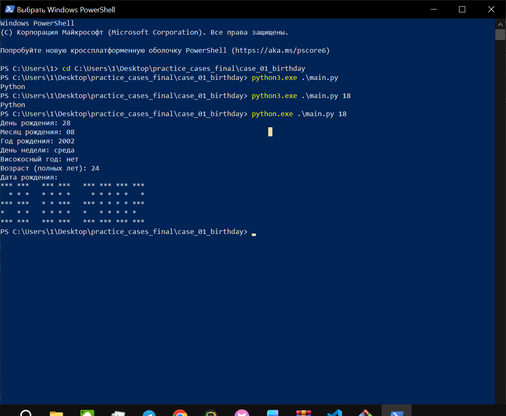

# Кейс № 1. Дата рождения на табло

Программа запрашивает день, месяц и год рождения, определяет день недели, високосность года и возраст в полных годах. Дата выводится звёздочками в формате ДД ММ ГГГГ. Для родившихся 29 февраля в невисокосный год возраст увеличивается 1 марта.

## Запуск

Требуется Python 3.10 или новее. Из корня проекта выполните:

```powershell
cd .\case_01_birthday
python main.py
```

При ручном запуске введите, например, `29`, `2` и `2000`, нажимая Enter после каждого числа.

## Три примера запуска

### 1. Високосный год

```powershell
29, 2, 2000 | python main.py
```

**Результат:** вторник, високосный год, 26 полных лет на 21.11.2026. Дата `29 02 2000` выводится звёздочками.

### 2. Обычный год

```powershell
1, 1, 2001 | python main.py
```

**Результат:** понедельник, обычный год, 25 полных лет на 21.11.2026. Дата `01 01 2001` выводится звёздочками.

### 3. Ошибка и повторный ввод

```powershell
29, 2, 1900, 1, 1, 2001 | python main.py
```

**Результат:** программа выводит «Введите существующую дату целыми числами.», повторно запрашивает дату и принимает `01.01.2001`.

Возраст в каждом запуске рассчитывается на текущую дату.
